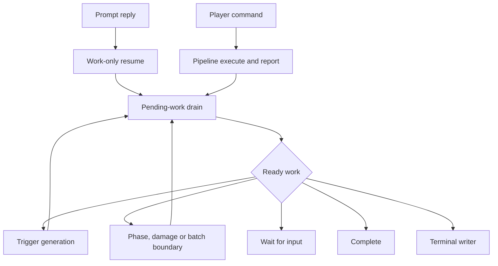

# 08 — Engine Architecture

This describes the implemented runtime after OPT-967. Schema authoring is covered by [01–07](./01-SCHEMA-OVERVIEW.md); individual rules and remaining gaps are in the [rules map](./RULES-TO-ENGINE-MAP.md). The [OPT-967 evidence](./OPT-967-DRAIN-EVIDENCE.md) records acceptance, compatibility, and the October audit disposition.

## State and boundaries

Transitions use snapshot-oriented, copy-on-write updates. Production does not deep-freeze the entire object graph. RNG, monotonic IDs, logical time, action budget, and trace context live in `GameState.executionContext`; core execution uses that recorded context. Executable dependencies live in the immutable `EffectResolverServices` bundle, never in persisted state.

`GameSession` is the Durable Object composition root. Session authorization validates game-scoped tokens; the coordinator serializes commands and applies action, prompt, turn, undo, and presence policy. Transport owns authoritative sockets, reconnect debounce, and filtered fan-out. Visibility produces each recipient's representation. Persistence validates, compacts, size-checks, and stores state, a separate immutable card DB, and bounded undo before terminal broadcasts. Engine-facing coordinators have no WebSocket/storage/network dependency.

History retains 256 recent events and up to 128 condition-critical anchors; older events become diagnostic counts. Undo retains one safe checkpoint. Persistence checks approximate per-value budgets before the storage ceiling. These are session boundaries, not work scheduled by the engine drain.

## Scheduling and pending work

Player commands enter `runPipeline`. Effect actions execute through resolver action handlers; prompt replies enter `resumePromptLifecycle`. A nested effect does not restart player validation. Each domain operation returns state, events, and any prompt or newly ready work. The one loop in `pending-work-drain.ts` advances trigger generations, phase stages, battle/effect damage continuations, replacement batch completion, and interrupted/batch action chains until it needs input, exhausts ready work, or reaches a terminal result.

Production domain handlers call `resolveEffectWork`; the service bundle's `resolveEffect` is also work-only. Public convenience APIs (`resolveEffect`, `resumeFromStack`, `resumeEffectChain`, phase helpers) enter the same drain at their external boundary. Session resume uses `resumeFromStackWork`, then the common drain, then reports its result through pipeline continuation. Specialized replacement and Life-reveal handlers consume their input and return ready work to that boundary. The coordinator's reveal surfacing delegates to the same drain. No scanner starts a private executor.

The historical `advanceTriggerExecution` export is an alias for the common drain. `advanceLifeTriggerExecution` is a bounded compatibility helper for direct reader probes; production battle/effect damage code no longer invokes it. `executePass` retains a direct-helper damage operation for callers outside the pipeline; production dispatch calls `executePassWork`. This does not create a second scheduling loop. See the route inventory in the evidence.

### Complete, wait, child, and resume

A waiting result preserves its continuation and returns immediately. Rejections, including legacy tagged waiting results without a fresh prompt, cannot fall through to completion. Before activating selected work, the drain consumes its selection so a resumed child cannot replay it. A child finishes before its interrupted parent proceeds. A resumed batch executes its next bounded operation and returns to the drain instead of privately advancing all other domains.

Existing effect-stack fields own durable work. Trigger owners store generations, selected work, and occurrence propagation. Domain frames retain typed phase/damage/replacement continuations. Reader conversion of supported legacy states remains in place. No new persisted field or schema version is introduced by OPT-967; existing fields carry a newly reachable conditional battle notification, whose rollback semantics require the explicit compatibility disposition below.

### Event obligations

Event publication and trigger matching are separate obligations. `eventLogEmitted` and `triggerScanned` independently mark an occurrence. Reports publish committed events, register new field sources, match triggers, perform departure cleanup, and enqueue work. They do not activate it. Explicit queued triggers, phase waves, and persisted work are additional sources; events are not the sole scheduling interface.

Immutable marker copies must replace the exact original occurrence in live frame accumulators as well as the outward result. Equal payloads from two distinct occurrences remain distinct. Staged hypothetical cost snapshots are not rewritten as live aliases. Prompt parking preserves unfinished propagation; completed propagation cannot replay after a later batch reentry or save/load. Terminal processing publishes committed prefixes before `GAME_OVER`, discards conditional next-step notifications, and clears all future work.

## Player pipeline and rule processing

The pipeline retains seven conceptual steps: validate, check prohibitions, check generic replacement entry, execute, report/drain triggers, recalculate, and rule processing. Prompted execution can return before the later steps. Phase action-history timing is preserved: an End Phase action parked before completion does not become a newly recorded `ADVANCE_PHASE` condition input merely because its work moved into the drain.

Applicable prohibitions run at their classified activation or resolution timing. The generic pipeline replacement function remains a stub; actual replacement interception and feasibility checks run at consequence sites. Shared replacement scanning/rechecking remains Phase 3 work (OPT-968/OPT-883/OPT-923). Replacement substitute actions use resolver handlers, rather than universally reentering player pipeline validation.

Rule processing runs at defined move, damage-determination, pre-prompt, action-end, and end-of-turn checkpoints. Deck-out uses deck count; Life-out requires a qualifying lethal damage determination, not merely zero Life. Damage paths carry their own checkpoint facts. A terminal outcome stops the remaining chain, queued work, phase handoff, and later damage points through the common terminal writer. Zero or negative power does not automatically K.O. a Character (rule 1-3-6-1-1).

## Trigger ordering

Registration follows the source zone and authored trigger schema. Matching collects work without resolving it. Within a simultaneous generation, the turn player chooses their order, then the opponent chooses theirs. Reports raised while older siblings resolve collect into a later cohort; that cohort is sealed after the older generation and its children finish. Historical closed generations remain separate.

The fixed-source regressions prove A→X→C (an attacking player's effect plays a Character, the already pending opponent effect resolves, then the new On Play) and A→B→C for same-player older siblings. `timing-baseline/nested-trigger-order.test.ts` retains independent gameplay expectations and complete traces through continuous, prompted, and reloaded paths. When Attacking precedes On Your Opponent's Attack; target-locked effects such as Ace run after the defending player's Blocker choice. This scheduling contract does not implement every unsupported trigger/custom-event rule.

Activation costs execute through the cost orchestrator and resumable cost handlers. They are not separate player pipeline commands. The `AND` action contract retains its preflight allowlist and atomic transaction behavior; conditional results remain governed by the resolver's existing `EffectResult` contract. Cost feasibility, prohibitions, and replacements retain their separate owners.

## Battle boundaries and damage

The drain performs the single step-end combatant checkpoint after the window's suspended work finishes. At Attack, Block, and Counter end, both attacker and current target must still occupy LEADER/CHARACTER; otherwise the engine emits `BATTLE_ABORTED` and one aborted `END_OF_BATTLE`, without entering the next legal action window or producing damage/battle-result events. This covers removal inside prompts and reloads (rules 7-1-1-4, 7-1-2-3, 7-1-3-3).

Battle subphase labels and existing redirect/blocker/target locks remain early. Attack→Block and Block→Counter notifications are held unmarked in the owning root frame's existing `accumulatedEvents` until its work quiesces. Generic publication, scanning, prefix release, and terminal flushing exclude these conditional occurrences. The owner detaches the occurrence before releasing or cancelling it; a nested owner's completion cannot release its parent's notification. On success it is published/scanned once; on removal or termination it is discarded. Counter→Damage is likewise cancelled before a failed checkpoint. Commands for a late Blocker or Counter are rejected while a decision is outstanding. Production SessionCoordinator admission also rejects unrelated actions during decisions; direct `runPipeline(PASS)` has an inherited helper-boundary limitation tracked by OPT-1000.

OP02-045 is a Counter Event that plays a Character with **no base effect**, not an On Play card. The authored regression separately uses OP05-018 playing OP05-011 to exercise a real On Play removal during Counter. OP16-080 redirect cost/target locks and reload remain covered by their existing persistence regression. OP06-048's Blocker mill precedes ST03-003's On Block bottom-deck effect; Ace's target check follows Blocker selection.

Damage retains ordinary-trigger deferral until its damage boundary completes, with the explicit Life Trigger interruption. Attacker damage effects finish before the Life-reveal prompt surfaces. Battle K.O. replacement prefixes retain their dedicated debt and resume once. OPT-967 changes scheduling ownership, not Double Attack determinations, damage amounts, or replacement matching semantics.

## End Phase and durations

The phase frame advances one rules stage per drain quantum. Stage order is the ending player's End of Your Turn wave, the opponent's End of Your Opponent's Turn wave, turn-player end-of-turn obligations and `until end` expiry, non-turn-player obligations and expiry, `during turn` expiry in player order, end-of-turn rule processing (including Brook), then handoff. Each wave recollects newly fulfilled obligations until quiescent. Children finish before the next stage. The phase frame is reused across reparks; scheduled actions form an ordered list, not a priority queue.

`TURN_ENDED`/`TURN_STARTED` are emitted at handoff. Modern staged End Phase marks `TURN_ENDED` already scanned because its keyword waves ran before handoff. The supported legacy scheduled-action path retains its historical post-handoff trigger behavior. `END_OF_YOUR_TURN` is an authored keyword mapping, not a separate runtime event token.

Scheduled entries retain source identity/controller and their stored action/snapshot contract; moving a source does not universally discard all delayed actions. The phase boundary's scaffolding source may follow its current child anchor; it does not replace the scheduled entry's source or a queued trigger's snapshot. `duration-tracker.ts` owns expiry and while-condition evaluation; battle expiry remains part of End of Battle.

## Effective values and limits

`modifiers.ts` derives effective power/cost from printed values, supported base-setting and additive effects, conditions, and DON!! rules. Cost floors at zero; power may be negative. Supported layer ordering is implementation-specific; this document makes no universal set-to-zero or simultaneous rest/activate winner guarantee. Keyword queries and applicable prohibitions retain their own timing.

Effect stack depth remains 100 and the persisted per-resolution action budget remains 1,000. Engine exhaustion writes an `ENGINE_LIMIT` terminal outcome, distinct from the Comprehensive Rules unstoppable-loop draw. Repeated-state detection and player-declared loop counts remain unimplemented (OPT-952). GE-11/12 guard immutable service construction, cost-module boundaries, work-only production scheduling, discriminated unions, and stored snapshot parsing; their existing protections remain alongside the new drain guards.

## Compatibility and evidence limits

Supported v1–v5 reader/converter paths remain. Actual synthetic pipeline-produced Attack/Block prompt saves were written through `SessionRepository`, replayed live and undo on the candidate and pinned baseline, then advanced to closure. Candidate behavior includes the corrected step checkpoint. The baseline can parse/load/resume them but retains its old premature next-step behavior; subsequent closure introduces no damage, duplicate battle end, or lost decision. Exact timestamp and allocated card/payload identity differences are pinned, not normalized. This is baseline-equivalent degraded rollback, not corrected OPT-951 semantics on the old engine.

Production capture/support-window retirement evidence remains the open OPT-971 gate; synthetic runs do not satisfy it. No legacy reader is retired. Complete acceptance sources, changed-expectation explanations, route inventory, and measured results are maintained in [OPT-967 evidence](./OPT-967-DRAIN-EVIDENCE.md), rather than inferred from a helper's name or a grep count.
